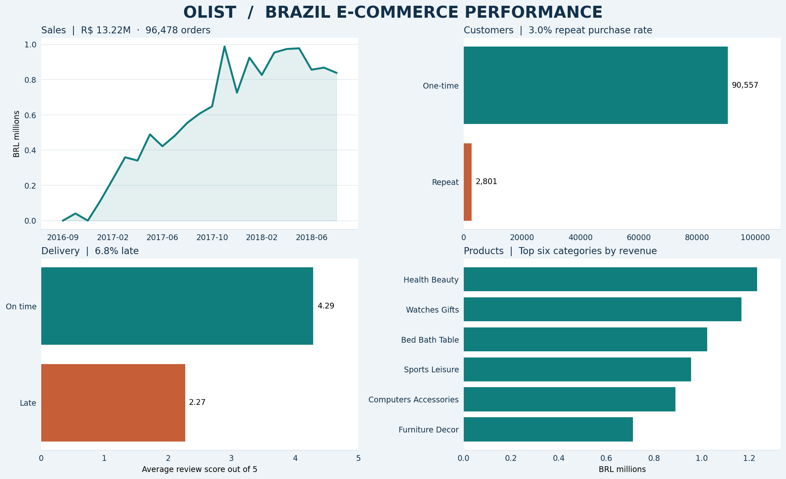

# Olist 巴西电商分析

Python · PostgreSQL · Pandas · Power BI

基于公开 Olist 数据的端到端分析。订单级分析覆盖购买、复购、配送和评分，商品与支付分析保留各自明细粒度。



[业务建议与指标口径](docs/report.zh-CN.md) · [数据质量审计](docs/data-quality.json) · [PostgreSQL 查询](sql/analytics.sql)

## 快速复现

从 [Olist Kaggle 数据页](https://www.kaggle.com/datasets/olistbr/brazilian-ecommerce) 下载数据 ZIP，将其保存为项目根目录下的 `archive.zip`。也可以将九张原始 CSV 放进同一目录，并将该目录作为脚本的输入。随附报告和预览使用用户上传的九张 CSV 重新生成。九个文件逐一与 Kaggle 公开版比较，内容完全一致。

在项目根目录运行，可先创建并启用 Python 虚拟环境。

```bash
python -m pip install -r requirements.txt
python src/prepare.py archive.zip
python src/analyze.py
```

使用 PostgreSQL 16 和一个拥有创建 schema 权限的连接。两个脚本都从项目根目录执行，方便客户端 `psql` 解析 CSV 路径。

```bash
psql "$DATABASE_URL" -f sql/load.sql
psql "$DATABASE_URL" -f sql/analytics.sql
```

`load.sql` 在事务中刷新专用的 `olist` schema。该脚本会替换此 schema 内六张数据表中的现有记录。

## Power BI Desktop

1. 在 Windows 上安装最新版 Power BI Desktop。若版本要求启用增强型 PBIR 或 Power BI 项目预览功能，在「选项 → 预览功能」启用后重启。
2. 从项目根目录运行以下命令，将数据路径替换为本机的绝对路径。生成器会更新 `powerbi/` 下的项目文件。

   ```powershell
   python src/build_powerbi.py "C:\Users\YourName\olist-project\data\clean"
   ```

3. 打开 `powerbi/Olist.pbip`。在 Power Query 参数 `DataFolder` 中也可修改 CSV 目录，参数路径以斜杠结尾。应用更改并刷新。
4. 检查 Sales Overview、Customer Analytics、Delivery Performance、Product Performance 页面。页面上的月份和州或品类筛选器作用于各自主题。预览图来自 Pandas，Power BI 页面样式和刷新仍需在 Desktop 中验证。

模型使用导入模式。Orders 的唯一订单键筛选 Items、Payments，Products 和 Sellers 分别通过唯一键筛选 Items。销售页面按支付金额展示支付结构。客户页面将所选时段拥有至少两笔已交付订单的买家归入复购，其余已交付买家归入一次性购买。品类筛选作用于商品指标，产品页的 Merchandise Orders 是该品类包含的独立已交付订单数。Revenue Share 的分母保留月份和其他筛选，跨全部品类。

## 数据粒度

| 表 | 粒度和主键 | 用途 |
| --- | --- | --- |
| Orders | 每笔订单，`order_id` | 客户、州、日期、履约和最近有效评分 |
| Items | 每笔订单的商品明细行，`(order_id, order_item_id)` | 商品收入、运费和件数 |
| Payments | 每笔订单的支付明细，`(order_id, payment_sequential)` | 支付结构 |
| Products | 每个商品，`product_id` | 品类 |
| Sellers | 每个卖家，`seller_id` | 发货州 |
| Geolocation | 每个有效邮编前缀 | 清洗后的坐标中位数 |

发布前核对数据源的使用条款。项目包包含代码、报告、汇总表与 Power BI 项目定义。原始文件和清洗后的明细通过 `.gitignore` 排除，复现时本地生成。

## 上传到 GitHub

解压项目包后，在 GitHub 建立一个空仓库，并在项目根目录运行以下命令。将远端 URL 换成自己的仓库地址。

```bash
git init -b main
git add .
git commit -m "Add Olist e-commerce analytics project"
git remote add origin https://github.com/YOUR-ACCOUNT/YOUR-REPO.git
git push -u origin main
```
